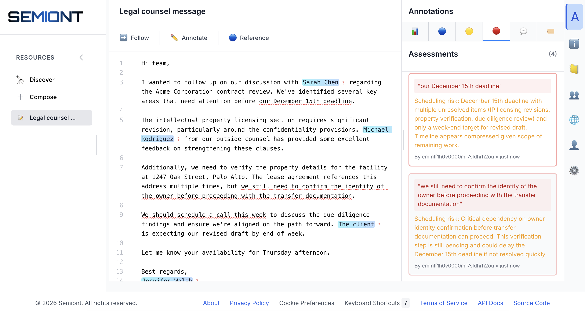

# Semiont

[](https://github.com/The-AI-Alliance/semiont/actions/workflows/ci.yml?query=branch%3Amain)

**Semiont is an open, source-grounded semantic knowledge platform for building and maintaining trusted AI knowledge bases and context layers. It gives humans and AI agents a shared workspace and architecture to annotate, connect, enrich, and govern domain knowledge for accurate applications, agents, and workflows.**



## Quick Start

```bash
brew install the-ai-alliance/semiont/semiont
```

Then follow the **[Quick Start](docs/builder/QUICK-START.md)**: create a knowledge base, start it, sign in, and annotate your first document.

To work in it from Claude or any other MCP client, once you have signed in:

```bash
claude mcp add semiont -- semiont mcp
```

**[Connecting an AI application](docs/builder/AI-APPLICATIONS.md)** has the rest.

## Documentation

- **[Analyst](docs/analyst/README.md)**: work in a knowledge base, annotating, linking, and reviewing what agents propose. A [demo knowledge base](docs/KNOWLEDGE-BASES.md) comes with content to start on.
- **[Operator](docs/operator/README.md)**: run a knowledge base, for yourself or for others, knowing its [architecture](docs/architecture/README.md).
- **[Builder](docs/builder/README.md)**: build an application, a script or an agent on the SDK, in TypeScript, Rust or Python, to the [protocol](docs/protocol/README.md) every SDK is held to.
- **[Contributor](docs/contributor/README.md)**: change Semiont itself.

## 📜 License

Apache 2.0 - See [LICENSE](LICENSE) for details.
