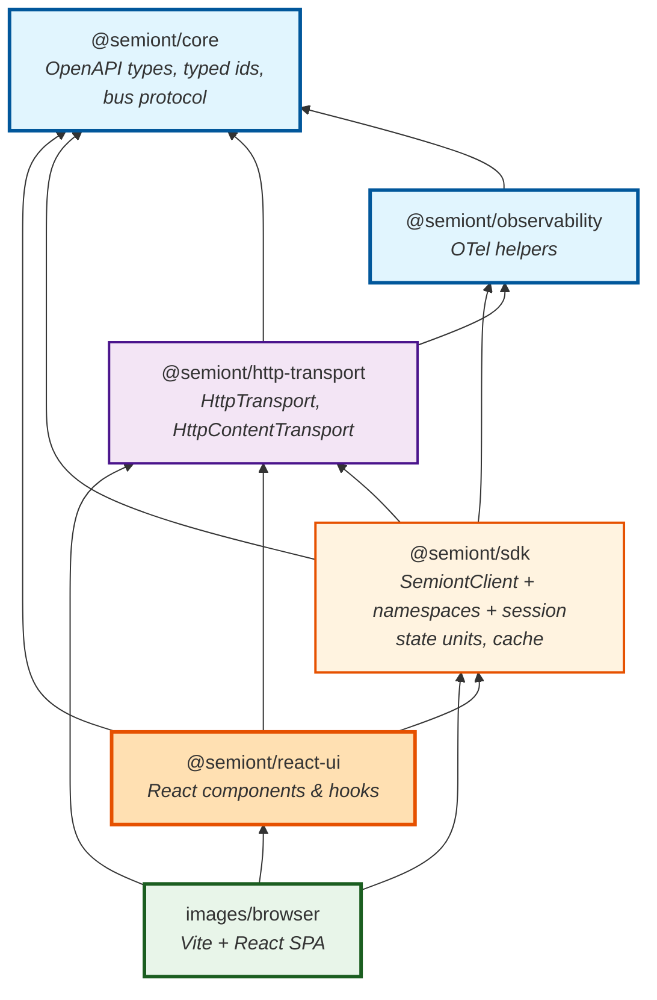
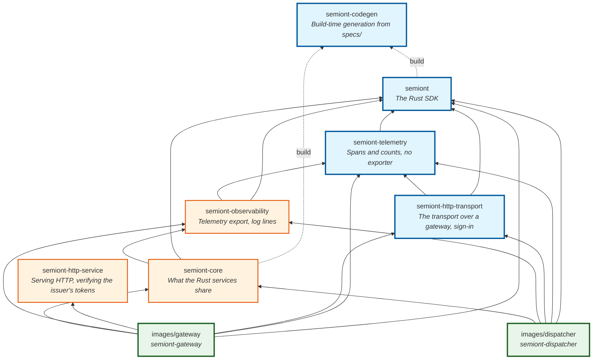

# Package Architecture

Semiont is a monorepo with two workspaces, the npm packages and the Rust crates, and nine Python projects and three Go modules beside them. No language's packages depend on another's. All are built against [`specs/`](../../specs/src/openapi.json), the protocol each implements from its side.

For what each package is and where it is published, see **[../../packages/README.md](../../packages/README.md)**: one table per language.

## The npm packages

The npm packages are the client side: what a TypeScript application reaches a knowledge base with. They are organized in layers from low-level primitives up; the Browser (`images/browser`) sits on top. No service is built from them.

Each edge is an entry in that package's `package.json` `dependencies`.

## The Rust crates

Four crates are published to crates.io: `semiont`, `semiont-http-transport`, `semiont-telemetry` and `semiont-codegen`. `semiont-core`, `semiont-observability` and `semiont-http-service` are the services' own. The dispatcher also has two crates of its own beside its binary, for its handlers and its JetStream queue. The Archivist has two as well, for its record and its staging drivers.

## The Python projects

`packages/sdk-python` is one distribution, `semiont`: the client, its transport over a gateway, sign-in, and telemetry with no exporter, which Rust keeps in four crates. It depends on `httpx`, `pydantic` and `opentelemetry-api`, and on nothing else in this repository. What it holds of `specs/` is generated, committed and held by drift gates.

`packages/inference-python` is `semiont-inference`: the model providers a Python service asks, behind one interface. It depends on `semiont`, and each provider's own library is an extra of it, required by nothing.

`packages/graph-python` is `semiont-graph`: the graph databases a Python service writes and reads, behind one interface. It depends on `semiont`, and each database's own client is an extra of it, required by nothing.

`packages/vectors-python` is `semiont-vectors`: the vector index a Python service writes and searches, and the embedding providers that make its vectors, each behind one interface. It depends on `semiont`, and asks a Qdrant and a provider over HTTP, so it takes no database's client and no provider's library.

`packages/service-python` is `semiont-service`: what every Python service does to be one, which is to read its configuration document, answer for its health, write its log and export its telemetry. It depends on `semiont`, and on OpenTelemetry's SDK and OTLP exporter, which only a process that exports takes. It is the services' own code, built into their images and published to no index.

`images/worker`, `images/weaver`, `images/smelter` and `images/librarian` are `semiont-worker`, `semiont-weaver`, `semiont-smelter` and `semiont-librarian`: the Worker, the Weaver, the Smelter and the Librarian. Each depends on `semiont`, on `semiont-service` and on more of the packages above: the Worker on `semiont-inference`, the Weaver on `semiont-graph`, the Smelter on `semiont-vectors`, and the Librarian on all three. The Smelter also takes `pypdfium2`, whose wheel carries PDFium, which reads a PDF. Nothing depends on a service: it is a service's code, run from its image, and published to no index.

## The Go modules

`packages/go/sdk` is one module, `github.com/The-AI-Alliance/semiont/packages/go/sdk`, package `semiont`: the client, its transport over a gateway, sign-in, the state units (package `state`) and the doubles a test is built on (package `semionttest`). It depends on `oapi-codegen`'s runtime, `google/uuid`, the OpenTelemetry API and `golang.org/x/text`, and on nothing else in this repository. What it holds of `specs/` is generated, committed and held by drift gates. It is published nowhere: a program in this repository requires it with a `replace` directive on its path.

`packages/go/sdk/conformance` is a module of its own: the three programs the conformance suite drives Go's SDK through (wire, live and worker), and the only Go code that takes an OpenTelemetry exporter.

`apps/launcher` is the `semiont` launcher: the binary that starts and stops a stack, signs a person in, and speaks the eight verbs at a terminal. Its commands on a knowledge base are front ends on `packages/go/sdk`, which it requires with a `replace` directive. It is built for each platform and released as an archive and through Homebrew.

## What each service image runs

| Image | Runs | From |
|---|---|---|
| `semiont-librarian` | `python -P -m semiont_librarian` | `images/librarian` |
| `semiont-smelter` | `python -P -m semiont_smelter` | `images/smelter` |
| `semiont-weaver` | `python -P -m semiont_weaver` | `images/weaver` |
| `semiont-worker` | `python -P -m semiont_worker` | `images/worker` |
| `semiont-browser` | the built SPA | `images/browser` |
| `semiont-gateway` | a Rust binary | `images/gateway` |
| `semiont-archivist` | a Rust binary | `images/archivist` |
| `semiont-dispatcher` | a Rust binary | `images/dispatcher` |

## Architectural principles

1. **One composition root per process.** Each service's entry point builds what that process needs and nothing else.

2. **Strict API boundary.** `images/browser` holds no service's code. Its only `@semiont/*` imports are `@semiont/sdk`, `@semiont/http-transport` and `@semiont/react-ui` — every interaction with a knowledge base goes through the SDK over `HttpTransport`.

3. **Layered dependencies.** A package depends only on packages in lower layers. No circular dependencies.

4. **The spec is the boundary between languages.** No package of one language depends on a package of another: not a crate, an npm package, a Python project or a Go module. What they agree on is in `specs/`, and each side generates its types from it.

5. **Platform independence.** The npm packages work in both a browser and Node.js. Where one has a Node-only part it is a subpath of its own (`@semiont/observability/node`).

## See also

- **[../../packages/README.md](../../packages/README.md)** — every package in each of the four languages, with what it is and whether it is published.
- **[KNOWLEDGE-SYSTEM.md](KNOWLEDGE-SYSTEM.md)** — the seven KB actors, and the service each runs in.
- **[CONTAINER-TOPOLOGY.md](../operator/CONTAINER-TOPOLOGY.md)** — how the service images fit together in a running stack.
